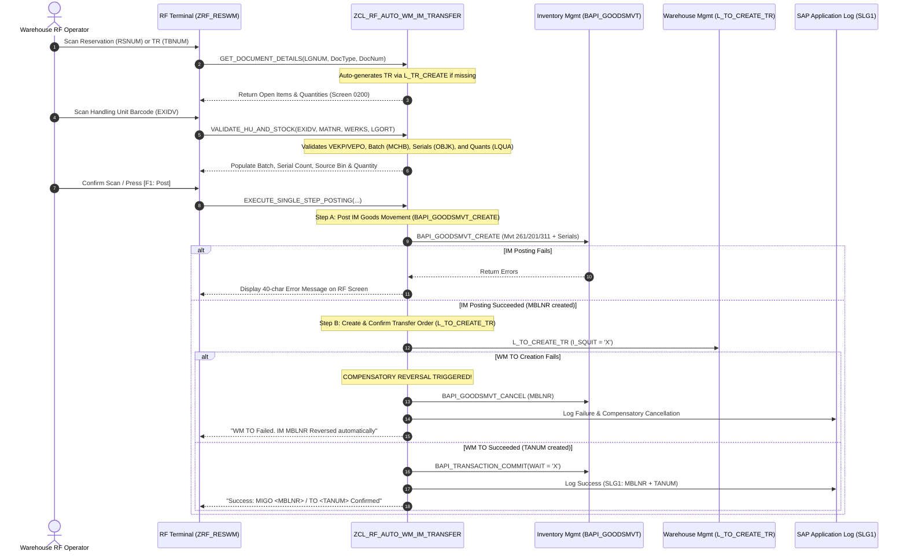

# Technical Specification & Architecture Design
## Custom Single-Transaction RF Scanning Application: Reservation-to-WM Transfer & Goods Issue

---

### 1. Executive Summary

In standard SAP ECC and S/4HANA systems, moving materials against a Reservation across Warehouse Management (LE-WM) and Inventory Management (IM) mandates multiple disconnected, manual transactions:
1. Creating/validating the Reservation (`MB21` / `MB23`).
2. Checking or generating a Transfer Requirement (`LB01` / `LB10`).
3. Creating a Transfer Order (`LT04` / `LT01`).
4. Physically picking Handling Units and confirming the Transfer Order (`LT12`).
5. Posting Goods Issue / Transfer Posting in IM (`MIGO` / `MB1A` / `MB1B`).

This solution delivers a **single-step, unified RF (Radio Frequency) barcode scanning transaction (`ZRF_RESWM`)** designed for rugged mobile barcode terminals (Zebra, Honeywell, Datalogic) running ITSmobile or SAP Console. It guarantees **atomic synchronization between IM and LE-WM**, validating Handling Units (HU), Batches, and Serial Numbers, and automatically executes both IM Goods Issue and WM Transfer Order confirmation in a single click with **zero orphan stock in interim storage types**.

---

### 2. End-to-End Process Flow

---

### 3. Solution Components & File Manifest

All development artifacts reside in the `RF Screen Development` workspace folder:

| Component | File Path | Description |
| :--- | :--- | :--- |
| **BAdI / Auto-TR** | [`src/zrf_reservation_badi.abap`](file:///Users/naresh/Documents/Github%20Development/SAPHANA/RF%20Screen%20Development/src/zrf_reservation_badi.abap) | Implementation of `MB_RESERVATION_BADI` (or `MBCF0007`) for automated TR generation on reservation save. |
| **Backend Class** | [`src/zcl_rf_auto_wm_im_transfer.clas.abap`](file:///Users/naresh/Documents/Github%20Development/SAPHANA/RF%20Screen%20Development/src/zcl_rf_auto_wm_im_transfer.clas.abap) | ABAP OO Controller with data extraction, HU/Batch/Serial validation, atomic posting, and compensatory LUW rollback. |
| **Main Program** | [`src/zrf_res_wm_transfer.prog.abap`](file:///Users/naresh/Documents/Github%20Development/SAPHANA/RF%20Screen%20Development/src/zrf_res_wm_transfer.prog.abap) | Module Pool program `SAPMZRF_RES_WM_TRANSFER` linked to transaction `ZRF_RESWM`. |
| **TOP Include** | [`src/zrf_res_wm_transfer_top.abap`](file:///Users/naresh/Documents/Github%20Development/SAPHANA/RF%20Screen%20Development/src/zrf_res_wm_transfer_top.abap) | Global data objects, screen structures (`G_SCR0100`, `G_SCR0200`), constants, and function codes. |
| **PBO Include** | [`src/zrf_res_wm_transfer_o01.abap`](file:///Users/naresh/Documents/Github%20Development/SAPHANA/RF%20Screen%20Development/src/zrf_res_wm_transfer_o01.abap) | Process Before Output modules for Screen 0100 & 0200 (PF-Status, cursor positioning, field mapping). |
| **PAI Include** | [`src/zrf_res_wm_transfer_i01.abap`](file:///Users/naresh/Documents/Github%20Development/SAPHANA/RF%20Screen%20Development/src/zrf_res_wm_transfer_i01.abap) | Process After Input modules (command evaluation, barcode trigger, navigation). |
| **Subroutines** | [`src/zrf_res_wm_transfer_f01.abap`](file:///Users/naresh/Documents/Github%20Development/SAPHANA/RF%20Screen%20Development/src/zrf_res_wm_transfer_f01.abap) | Subroutines for data retrieval, validation dispatch, serial number inspection, and stock bin discovery. |
| **Screen 0100 Spec**| [`screens/screen_0100.txt`](file:///Users/naresh/Documents/Github%20Development/SAPHANA/RF%20Screen%20Development/screens/screen_0100.txt) | Dynpro layout attributes, flow logic, and element positioning for Selection Screen. |
| **Screen 0200 Spec**| [`screens/screen_0200.txt`](file:///Users/naresh/Documents/Github%20Development/SAPHANA/RF%20Screen%20Development/screens/screen_0200.txt) | Dynpro layout attributes, flow logic, and element positioning for Scan/Execution Screen. |
| **ITSmobile 0100** | [`templates/itsp_screen_0100.html`](file:///Users/naresh/Documents/Github%20Development/SAPHANA/RF%20Screen%20Development/templates/itsp_screen_0100.html) | Mobile HTML5 template for Screen 0100 with barcode auto-focus and high-contrast green-on-black UI. |
| **ITSmobile 0200** | [`templates/itsp_screen_0200.html`](file:///Users/naresh/Documents/Github%20Development/SAPHANA/RF%20Screen%20Development/templates/itsp_screen_0200.html) | Mobile HTML5 template for Screen 0200 with dynamic scan handling, touch function keys, and card layout. |
| **Deployment** | [`deploy/deploy_rf_program.cjs`](file:///Users/naresh/Documents/Github%20Development/SAPHANA/RF%20Screen%20Development/deploy/deploy_rf_program.cjs) | Automated Node.js ADT deployment script to compile and activate objects on SAP DS4/220. |

---

### 4. Technical Architecture & Design Decisions

#### A. Background Auto-TR Generation (Reservation Save)
1. **Trigger Points**:
   - Primary: BAdI `MB_RESERVATION_BADI` (Method `DATA_CHANGED`).
   - Classic Alternative: Customer Exit `EXIT_SAPMM07R_001` (Include `ZXMBCU07` in Enhancement `MBCF0007`).
   - Run-time Fallback: Method `ZCL_RF_AUTO_WM_IM_TRANSFER=>ENSURE_TR_EXISTS` automatically generates the TR upon scanning if missing.
2. **Warehouse Determination**:
   - Evaluates Plant (`WERKS`) and Storage Location (`LGORT`) against table `T320` and `T001L`.
   - Filters out deleted (`XLOEK = 'X'`) and finalized (`KZEAR = 'X'`) reservation items.
   - Calculates open balance: `BDMNG - ENMNG`.
3. **TR Creation API**:
   - Calls standard function module `L_TR_CREATE` with Requirement Type `BETYP = 'P'` (Material Reservation) and Requirement Number `BENUM = RSNUM`.

#### B. Handheld Barcode Scanning Ergonomics (Screens 0100 & 0200)
1. **Screen Format**: 16 lines by 20/40 columns character resolution (Standard industrial RF terminal standard).
2. **Scanner Action**: When the operator scans a barcode into `G_SCR0200-EXIDV_SCAN`, the scanner hardware appends a carriage return (`Enter` / `ENTR`), which automatically triggers PAI without requiring a touch or manual keystroke.
3. **Status Line**: Strictly constrained to 40 characters for instant readability on small screens without scrolling or line breaks.
4. **Function Key Mapping**:
   - `F1`: Execute Posting (Atomic IM + WM Commit)
   - `F2`: Next Open Item
   - `F3`: Back to Selection Screen
   - `F4`: Clear Current Input
   - `F6`: View Serial Numbers in Scanned HU
   - `F7`: Show Available Stock Storage Bins

#### C. Validation Logic (`VALIDATE_HU_AND_STOCK`)
* **Handling Unit (`VEKP`/`VEPO`)**:
  - Verifies HU exists and status is active (rejects archived `0060` or emptied HUs).
  - Validates packed Material against Reservation item Material.
  - Ensures Plant and Storage Location match.
* **Batch (`MCHB`)**:
  - If a batch was pre-assigned on the Reservation (`RESB-CHARG`), validates exact batch match.
  - Verifies unrestricted batch stock (`CLABS`).
* **Serial Numbers (`OBJK`/`SER06`)**:
  - If material is serialized (`MARC-SERNP` is active), extracts serial numbers packed within the HU via `SER06` (`VENUM`) and `OBJK` (`OBKNR`).
  - Passes all serial numbers to `BAPI_GOODSMVT_CREATE` table `GOODSMVT_SERIALNUMBER`.
* **LE-WM Quant & Bin (`LQUA`)**:
  - Confirms the HU/Storage Unit (`LENUM`) resides in an active WM bin.
  - Verifies Quant is not blocked for removal (`SKZUA = ' '`), not blocked for placement (`SKZUE = ' '`), and not undergoing physical inventory (`EINME = ' '`).
  - Guards against scanning HUs already in interim storage types (`LGTYP` starting with `9xx`).

#### D. Atomic LUW & Compensatory Rollback (Zero Orphan Stock Guarantee)
In standard SAP, if IM Goods Issue is posted first and LE-WM Transfer Order creation fails (e.g. storage bin blocked, capacity exceeded, or lock error), positive stock remains stuck in interim storage type `911` / `922`.

To eliminate orphan stock completely:
1. **Pre-Check**: Validates Quant lock and availability prior to executing any database writes.
2. **Step A**: Executes `BAPI_GOODSMVT_CREATE`.
3. **Step B**: Immediately creates and confirms the Transfer Order (`L_TO_CREATE_TR` / `L_TO_CREATE_SINGLE` with `I_SQUIT = 'X'`).
4. **Compensatory Rollback**:
   - If Step B encounters any error (`sy-subrc <> 0` or blank `TANUM`):
     - The program **immediately calls `BAPI_GOODSMVT_CANCEL`** for the newly created Material Document `MBLNR`.
     - Executes `BAPI_TRANSACTION_COMMIT( WAIT = 'X' )` to finalize the cancellation.
     - Logs the incident in `SLG1` and notifies the operator on the RF screen:
       `"WM TO Failed (rc=X). IM <MBLNR> Reversed."`
   - If both succeed:
     - Calls `BAPI_TRANSACTION_COMMIT( WAIT = 'X' )`.

---

### 5. Application Logging & Supportability (`SLG1`)

All transactions, whether successful or failed, are logged in the SAP Application Log:
* **Object**: `ZRF_WM`
* **Subobject**: `RES_TRANSFER`
* **External ID**: `RF-<DOC_NUM>-<DATE>-<TIME>`
* **Logged Attributes**:
  - Operator User ID (`sy-uname`) and Program Name.
  - Scanned Handling Unit (`EXIDV`) and Document Number.
  - Resulting Material Document (`MBLNR`/`MJAHR`) and Transfer Order Number (`TANUM`).
  - Complete return messages from `BAPIRET2` for fast production RCA.

---

### 6. SPRO Customizing & Configuration Prerequisites

1. **Warehouse Assignment (`T320`)**:
   - Ensure the Plant (`WERKS`) and Storage Location (`LGORT`) are assigned to the target Warehouse Number (`LGNUM`).
2. **Application Log Object (`SLG0`)**:
   - Create Object `ZRF_WM` with Subobject `RES_TRANSFER`.
3. **Transaction Code (`SE93`)**:
   - Transaction: `ZRF_RESWM`
   - Program: `SAPMZRF_RES_WM_TRANSFER`
   - Initial Screen: `0100`
   - Check "SAP GUI for HTML" / "Inherit GUI size".
4. **SICF ITSmobile Service**:
   - Create ICF service under `/default_host/sap/bc/gui/sap/its/zrf_reswm`.
   - Handler: `CL_HTTP_EXT_ITS`.
   - GUI Configuration Parameters:
     - `~THEME`: `99`
     - `~TRANSACTION`: `ZRF_RESWM`
     - `~POPUPS`: `1`
     - `~ITSMOBILE`: `1`
     - `~AUTOLOGON`: Optional based on device authentication certificate.
